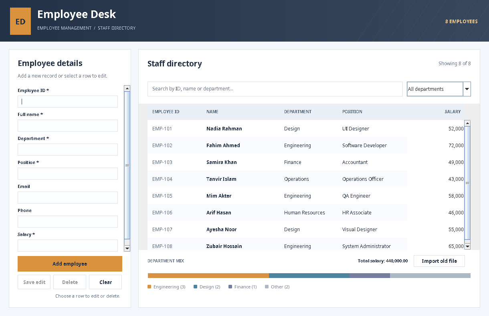

# Employee Desk

A small employee management desktop program written in Java Swing. I originally built the project to practice Java classes, inheritance, file handling and event-driven programming. This version replaces the text-based record display with a more practical staff directory.



## What it does

- Add employees with an ID, name, department, position, contact details and salary.
- Select an employee from the table to edit or remove their record.
- Search by name, employee ID, department, position, email or phone number.
- Filter the table by department and sort columns, including salary.
- See a simple visual breakdown of employees by department and the total salary amount.
- Save changes to a local text file so records are available when the program reopens.
- Import employee records from the original coursework file format.

No third-party libraries or database server are needed.

## Run the program

Install JDK 8 or newer. From the project folder, run:

```bash
mkdir out
javac -encoding UTF-8 -d out -sourcepath src src/Start.java
java -cp out Start
```

On Windows, the same commands work in a terminal with Java installed; replace `/` with `\` in the Java source path if needed.

Alternatively, if you download the separately provided application JAR:

```bash
java -jar EmployeeDesk_Java_App.jar
```

The application opens with an empty directory. To try it with fictional records, click **Import old file** and select `examples/sample-employees.txt`.

## Using the directory

1. Enter the required fields (marked with `*`) and click **Add employee**.
2. Click a row to load an existing record into the form. Change its fields and press **Save edit**.
3. Use **Delete** to remove the selected employee. The program asks for confirmation.
4. Use **Clear** before creating another employee.
5. Type in the search box or choose a department to narrow the list.

Employee IDs must be unique. Salary must be a number greater than or equal to zero. An ID cannot be changed once the employee has been created.

## Where records are saved

The program keeps data in the current computer user's home directory:

- Windows: `C:\Users\<your-name>\.employee-desk\employees.txt`
- macOS/Linux: `~/.employee-desk/employees.txt`

This data file is **not included** in the GitHub project. Records are plain text and are not encrypted. This is an educational desktop application, **not** a production HR or payroll system, so do not put confidential real-world employee data in it.

The original project stored password and security-answer fields along with employee details. Those fields are not used in this version. Importing an original `employees.txt` file keeps the ID, name, email, phone, position and salary; it discards passwords and security answers and puts imported employees in a default `General` department.

## Project files

| File | Responsibility |
| --- | --- |
| `src/models/User.java` | Common user details and getter/setter methods |
| `src/models/Employee.java` | Employee fields, inheritance and text conversion |
| `src/Controllers/EmployeeController.java` | Add, edit, delete, search and import operations |
| `src/Controllers/FileIO.java` | Read and write UTF-8 text files |
| `src/UI/EmployeeManagementUI.java` | Swing form, table, filters and department chart |
| `src/Start.java` | Application entry point |
| `tests/` | Controller tests and a GUI smoke test using plain Java |
| `examples/` | Fictional employee records for trying the interface |

## Run tests

```bash
javac -encoding UTF-8 -d out -sourcepath src src/Start.java tests/EmployeeControllerTest.java
java -cp out EmployeeControllerTest
```

The GUI smoke test also needs a graphical desktop session:

```bash
javac -encoding UTF-8 -cp out -d out tests/EmployeeUITest.java
java -cp out EmployeeUITest
```

The original coursework design and the reasons for the changes are outlined in [PROJECT_NOTES.md](PROJECT_NOTES.md).
